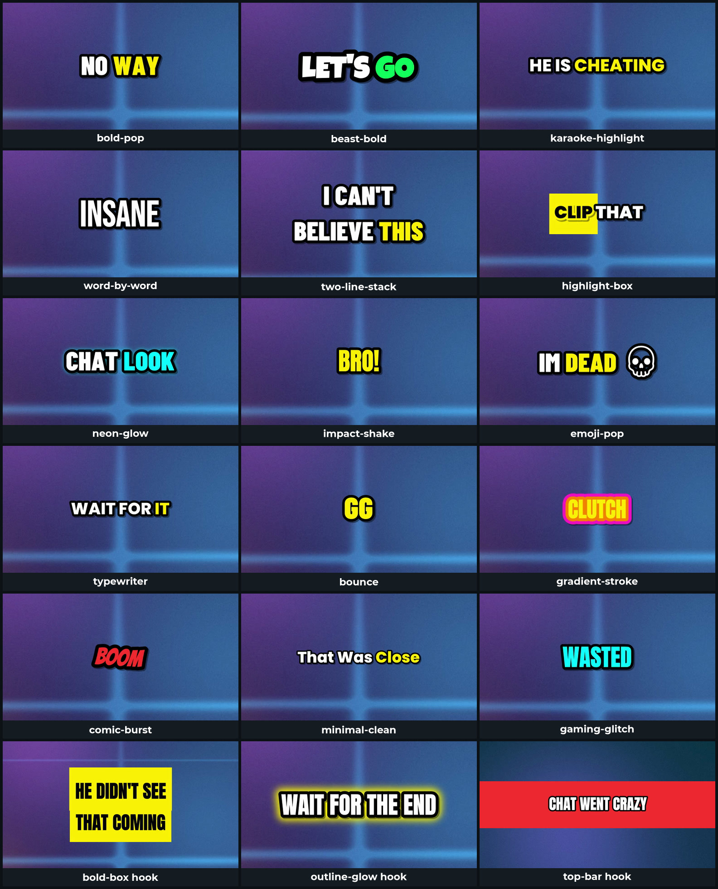

# StreamClipper: full guide

Everything in detail. For the short version, see the [README](../README.md).

## What it does

1. Downloads only the audio of a stream (or reads a local file) and transcribes the whole stream in 10-minute chunks with faster-whisper. Progress is saved after every chunk, so an interrupted run continues where it stopped.
2. Finds every moment worth posting: voice reaction peaks, English stream slang ("no way", "let's go", "clip that", "bro", "W", "GG" ...), laughter, chat replay spikes and, on YouTube, the Most Replayed graph. Each clip is cut as a story (setup, tension, payoff, reaction), never inside a word, with dead air trimmed.
3. Scores each clip 0-100 with a breakdown (hook, story, emotion, pacing, engagement), a one-line reason and a category (funny, rage, clutch, reaction, fail, hot take, reveal, wholesome, chaos). The ranked list goes to `clips.json`, `clips.csv` and a static `index.html`.
4. Renders MP4s (1080x1920, 30 fps, -11 LUFS) with one of 15 caption styles, a hook headline, sound effects and a thumbnail, and checks every file with an export gate.
5. Writes the same clips as CapCut Desktop drafts, with every layer on its own track, so you can fix anything by hand.

## Status

What has been tested, and how. Numbers come from the test runs listed here, not from estimates.

| Mode | Status | Tested on |
|---|---|---|
| VOD (`discover-clips`, `clip-stream`, `render`) | stable | A real 44-min English gameplay stream and a calm 53-min VOD. On a hand-labelled set of 53 candidate windows from these two streams, 87% (busy stream) and 100% (calm stream) of the selected clips are post-worthy, and no big moment is missed. The labels and the tuning used the same two streams, so treat these numbers as optimistic. |
| Live (`live`) | new | One 12-min run on a real English Twitch stream (1080p60): stable ingest, 0 reconnects, Twitch chat read. Clips were ready a median 34 s (max 54 s) after the moment. That run made 4 clips, and 3 passed the export gate; the fourth was too quiet, a loudness bug fixed since then. The same recording replayed through the live path with the final code gave 8 clips, all 8 passing the gate (median 35 s, max 57 s). A fake-live test with planted reactions found 3 of 3. YouTube Live chat and Kick are not tested yet. |
| Podcast (`--preset podcast-9x16`) | beta | One 5-min slice of a two-person interview show with several cameras: 3 clips, all passing the export gate and the caption sync check, faces never cut. One test video only. |
| Colab notebook | tested in Docker | The whole notebook ran in a Linux container (python:3.12-slim, CPU only). A real Colab T4 run is still to be done. |

## StreamClipper and paid clipping tools

| | StreamClipper | Paid cloud clippers |
|---|---|---|
| Price | free, AGPL-3.0 licence | monthly plans |
| Stream length | no limit (8-10 h streams are chunked and resumable) | limited per plan |
| Clips per stream | every clip that passes the quality bar, ranked (quality over quantity) | depends on the plan |
| Score with breakdown and reason | yes | yes |
| Animated caption styles | 15 styles, 3 hook banner styles | yes, more templates |
| Editable project files | CapCut Desktop drafts | usually their own web editor |
| Layouts | facecam + gameplay split, square frame, full frame, hook-grabber, speaker (podcasts) | yes |
| Live clipping (clips while the stream runs) | yes, `streamclipper live` | some |
| Face tracking / multi-person reframe | podcast layout (beta): the crop follows the face, two people are stacked | yes |
| Speed | depends on your GPU or the Colab T4 | faster, on their cloud GPUs |
| Auto-posting and scheduling | no | yes |
| Languages | English first; Hindi (Devanagari) and other Whisper languages | varies |
| Your files stay with you | yes (your PC or your Google Drive) | uploaded to their servers |

For reference, as of 17 Nov 2026: OpusClip's free plan adds a watermark and gives 60 credits a month, and its paid plans start at $15/month ([opus.pro/pricing](https://www.opus.pro/pricing)). ScaleReach's Pro plan costs $18/month (billed monthly) and takes files of up to 3 hours ([scalereach.ai](https://www.scalereach.ai/)). Both are polished products with features StreamClipper doesn't have, such as auto-posting, a web editor and cloud speed. StreamClipper is free, has no length limit, clips live streams, and gives you editable CapCut drafts.

## Quickstart: Google Colab (no strong PC needed)

1. Click **Open in Colab** above, then choose **Runtime > Change runtime type > T4 GPU**.
2. Run the cells from top to bottom. Paste a stream link (or the Drive path of a video you uploaded) in cell 5 and pick the options in cell 6.
3. Get the results from `MyDrive/StreamClipper/` on Google Drive: MP4s, thumbnails, `clips.csv`, `index.html` and `capcut_drafts.zip`. To edit in CapCut, copy `capcut_drafts.zip` to the repo folder on your Windows PC, close CapCut and run:

```powershell
streamclipper import-draft --zip capcut_drafts.zip
```

The notebook uses only form fields and inline previews (no web UI, no share links), so it works on the free tier. If YouTube answers "Sign in to confirm you're not a bot" (common on Colab), upload the VOD to Drive and use its path, or set a `cookies.txt` path in cell 5. A cookies file gives access to your account: never share it.

## Quickstart: Windows PC

You need Python 3.10 or newer and ffmpeg (`winget install Gyan.FFmpeg`, then open a new terminal). Open PowerShell in the repo folder and put your stream recording there as `my_stream.mp4`.

### With an NVIDIA GPU

```powershell
python -m pip install -e ".[asr,gpu,vision,dev]"
streamclipper doctor
streamclipper discover-clips --video my_stream.mp4 --out clips.json
streamclipper render --clips clips.json --video my_stream.mp4 --max-clips 3 --out renders
streamclipper audit --mp4 renders\clip_01.mp4
streamclipper clip-stream --input my_stream.mp4 --out work --prefix MyClip --max-clips 3 --render
streamclipper audit --draft MyClip_01
```

1. `pip install` installs the `streamclipper` command, faster-whisper, the CUDA libraries, OpenCV for face detection (`vision`) and the test tools (`dev`).
2. `doctor` checks Python, ffmpeg, yt-dlp, Whisper, CUDA, CapCut, fonts and effects, with a fix for each missing item.
3. `discover-clips` transcribes and scores the stream and writes `clips.json`, `clips.csv`, `index.html` and preview images. Nothing is rendered yet. Open `index.html` to see the ranked list.
4. `render --clips` makes MP4s and thumbnails of the 3 best clips in `renders\` (no CapCut needed). It leaves `clips.json` as it is and writes the MP4 links to `clips_rendered.json` (+ `clips_rendered.csv`, `clips_rendered.html`) next to it.
5. `audit --mp4` runs the export gate on an MP4 again.
6. `clip-stream` does discovery and builds one CapCut draft per clip (`MyClip_01`, `MyClip_02`, `MyClip_03`), and with `--render` also the MP4s in `work\`. Close CapCut Desktop first. All clips above the score go to `work\clips.json`; `--max-clips 0` makes drafts for all of them.
7. `audit --draft` checks a draft: files, materials, track overlaps, caption ranges and registration in CapCut's draft list.

### Without a GPU (CPU only)

```powershell
python -m pip install -e ".[asr,vision]"
streamclipper discover-clips --video my_stream.mp4 --out clips.json --device cpu
streamclipper render --clips clips.json --video my_stream.mp4 --max-clips 1 --caption-style karaoke-highlight --out renders
```

On a CPU the automatic Whisper model is `small` for streams up to 30 minutes and `base` for longer ones (see Measured speeds).

`python scripts\capcut_studio.py <command>` still works and runs the same CLI, with or without `pip install`.

### More examples

```powershell
streamclipper styles
streamclipper styles --preview --out style_previews
streamclipper discover-clips --url https://youtu.be/VX8hvc4WMN4 --out yt_clips.json
streamclipper render --clips clips.json --video my_stream.mp4 --max-clips 1 --preset square-frame-9x16 --caption-style comic-burst --hook-style top-bar --out renders
streamclipper render --clips clips.json --video my_stream.mp4 --max-clips 1 --ratio 1:1 --prefix square --out renders
streamclipper render --clips clips.json --video my_stream.mp4 --max-clips 1 --preset hook-grabber-9x16 --filler-video filler.mp4 --prefix grabber --out renders
streamclipper download-vod --url https://youtu.be/VX8hvc4WMN4 --start 60 --end 70 --out slice.mp4
streamclipper build-clipper --spec clip_spec.json --render
```

- `styles` lists the caption styles, hook styles and caption fonts. `styles --preview` renders a 4 s sample MP4 and PNG of each one into `style_previews\` plus `styles_gallery.jpg` (about 2 minutes).
- `discover-clips --url` downloads the audio only; on YouTube it also uses the Most Replayed graph and the live chat replay when the video has one.
- `--preset hook-grabber-9x16` puts the clip on top and a muted `filler.mp4` (footage you have the rights to) below it.
- `download-vod` downloads 60-70 s of a video as H.264/AAC MP4 (at most 1080p).
- `build-clipper` builds one clip from a hand-written spec (see Clip spec).

Names are never overwritten: if `MyClip_01` (draft or MP4) exists, the new one becomes `MyClip_01_2`. Pass `--overwrite` to replace it.

## Live clipping quickstart

`streamclipper live` clips a stream while it is still running, so clips are ready minutes after a moment instead of after the stream ends. It works with Twitch, YouTube Live and Kick (Kick is best-effort), an `.m3u8` link or a local file.

```powershell
python -m pip install -e ".[asr,gpu,vision,dev]"
streamclipper live --url https://www.twitch.tv/<channel> --out live_clips --render
```

- The stream is recorded into 10-second pieces in `live_clips\buffer\` (the last 15 minutes are kept; set `--buffer-min`). The tool deletes only the pieces it recorded itself.
- Every new piece is transcribed with Whisper, and the same scoring and quality bar as the VOD mode runs on the last 10 minutes. When a moment passes the bar, the tool waits until the reaction ends (at most 20 s), then cuts the clip from the buffer and renders it in the background.
- The console prints one line per clip, for example:
  `CLIP 01 | 01:05 into stream | score 56 | '75 Gold Right Now?' | live_clips/LIVE_01.mp4 | ready 57 s after the moment | gate PASS`
- `clips.json`, `clips.csv` and `index.html` in `live_clips\` are updated after every clip.
- Press **Ctrl+C** to stop. The clip being rendered and the clips that are already queued are finished first (renders run in their own process group, so the key press reaches only streamclipper). `--stop-after 60` stops after 60 minutes; by default it runs until the stream ends.
- Disk use stays bounded: each moment's window file in `live_clips\windows\` is deleted once its clip is made (a failed clip keeps its window for a re-run). The panel files in `panels\` stay, because CapCut drafts and the re-render command use them. `--max-disk-gb 20` (default) prints a warning when the output folder grows past 20 GB; nothing else is deleted.
- Limits: `--max-clips-per-hour 12` (default) caps the output, `--min-score` is the same quality bar as in the VOD mode, and `--prefix` sets the file names. `--chat off` skips the Twitch/YouTube chat signal. The layout, caption and draft flags are the same as in `clip-stream`.
- On Colab, cell **10. Live clipping (optional)** does the same: paste the stream link, set how many minutes to run, and the clips go to `MyDrive/StreamClipper/live/`. The rolling recording stays on the Colab disk (`/content/streamclipper_live/`); only finished clips, thumbnails, `clips.json`, `clips.csv` and `index.html` are copied to Drive, after every clip, so the recording never fills your Drive or its trash.

## Podcasts and interviews (beta)

```powershell
streamclipper clip-stream --input my_podcast.mp4 --out podcast_work --preset podcast-9x16 --render
```

- `--preset podcast-9x16` sets `--content talk` and the `speaker` layout. Clips are picked from what is said: strong lines ("here's the thing", "nobody talks about", "are you serious", amounts like $500), laughter and, with `--llm`, self-contained stories and punchlines. A calm conversation does not need loud moments to give clips.
- The `speaker` layout works shot by shot. When one face is on screen, the 9:16 crop follows it slowly (at most 4% of the frame width per second, so it never jitters). Two people side by side are stacked, left person on top. B-roll without a face is shown whole over a blurred fill. Black frames between shots are cut out when nobody is speaking.
- Face detection needs OpenCV (`pip install -e ".[vision]"`; Colab has it). Without it, every shot is shown whole.
- `--content talk` also works with `discover-clips` and `live`, for example: `streamclipper discover-clips --video my_podcast.mp4 --out podcast_clips.json --content talk`.

## Quality over quantity

The goal is clips you would post, not a high clip count. A clip is kept only when it has a setup, a payoff that stands out and a reaction after it, with real words in it. A calm 1-hour stream may give only 4 clips, and that is the intended result.

- `--max-clips` is a cap, not a target: 0 keeps every clip that passes the bar.
- `--min-score` (default 50) is the score part of the bar. Lower it (for example `--min-score 40`) to see more candidates, or use `--min-score 0` to list every candidate without the bar. Check `index.html` before posting.
- Clips are at most 60 s (`--max-dur 60`), and rendered clips stay at or below 59.5 s, so they fit YouTube Shorts, Reels and TikTok.

## Does it need AI?

Not a paid one, and no API key. Clips are found from the audio (voice peaks, laughter, silence), the words (Whisper speech recognition) and rules (trigger phrases, the quality bar). Whisper is an open model that runs on your GPU, your CPU or the Colab GPU. Nothing is sent to an online service.

An LLM is optional: `--llm ollama` runs a local model (free), and `--llm gemini` uses your own free key in env `GEMINI_API_KEY`. It adds story segments, hooks, titles and hashtags. Without it, every clip still gets a title, a description and hashtags written by simple rules.

## How clips are found and scored

- **Candidates.** Every voice peak at least 6 dB above the stream's rolling 60 s median, every chat replay spike (messages per second against a rolling 120 s median, plus words like KEKW, LUL, W, "clip it", 😂, 💀) and, with `--llm`, every payoff the LLM proposes.
- **Story window.** The start is the sentence end or silence 10-25 s before the peak with the longest pause before it. The end is the first pause 2-5 s after the peak, so the reaction plays out. Pauses over `--min-pause` (0.55 s) are trimmed, except around the peak.
- **Score.** Five 0-100 components, weighted and renormalised over the ones that are available:

| Component | Weight | From |
|---|---|---|
| hook | 20 | a trigger word or strong phrase in the first 2 s (needs a transcript) |
| story | 25 | payoff louder than setup, reaction coverage, LLM story score |
| emotion | 25 | reaction intensity, shock, laughter and screams |
| pacing | 10 | speech rate and dead air removed |
| engagement | 20 | chat spike and YouTube Most Replayed (only when available) |

- **Selection.** Only clips that pass a quality bar are kept: a score of at least `--min-score` (default 50; 40 for a scream or a line like "finally" or "I did it"), a setup before the payoff, a payoff that stands out from the usual voice level, a reaction after it, and real words (a chant or a transcription loop fails). Clips are picked best first without overlaps; `--max-clips` is a cap, not a target (0 = all that pass). A calm stream can give only a few clips, which is the point. `--min-score 0` lists every candidate without the bar. On the labelled test set (`python tools/eval_selection.py`) 87-100% of the selected clips are post-worthy and no big moment is missed.
- **Titles without an LLM.** With `--llm none` every clip still gets a title (from the hook, in Title Case, unique per stream), a one-sentence description and hashtags (category, keywords, `#shorts #gaming`; `#GTA6` only when the stream mentions GTA).
- **Categories.** A rule table maps words and sounds to a category; with `--llm` the LLM's category is used.
- **LLM (optional).** `--llm ollama` (local, free) or `--llm gemini` (your own free key in env `GEMINI_API_KEY`) reads the transcript in 8-minute chunks and proposes story segments, a hook, a title, a description and hashtags. Everything works with `--llm none` (the default); titles, descriptions and hashtags then come from the rules above.

## Reference

### Commands

| Command | What it does |
|---|---|
| `doctor` | Checks Python, ffmpeg (libass, harfbuzz, filters), yt-dlp, numpy, faster-whisper, CUDA, CapCut, draft folder, fonts, effects and SFX. |
| `discover-clips` | Finds and scores clips in a file or URL; writes `clips.json`, `clips.csv`, `index.html`. |
| `live` | Clips a stream while it is live (Twitch, YouTube Live, Kick, `.m3u8`, or a file); see Live clipping quickstart. |
| `clip-stream` | Discovery plus one CapCut draft per clip; `--render` adds MP4s and thumbnails. |
| `render` | MP4s only, from `clips.json` (`--clips`), a clip plan (`<name>.clip.json`) or a clip spec (`--spec`). |
| `build` / `build-clipper` | One draft from a clip spec or a low-level timeline spec; `--render` adds the MP4. |
| `import-draft` | Imports a zip of drafts (for example `capcut_drafts.zip` from Colab) into CapCut Desktop and relinks the media. |
| `styles` | Lists caption styles, hook styles and caption fonts; `--preview` renders a sample of each. |
| `download-vod` | Downloads a time range of a video as H.264/AAC MP4. |
| `audit` | `--draft NAME` checks a draft; `--mp4 FILE` runs the export gate. |
| `analyze` | Older analysis command: speech islands, webcam box, optional Whisper words and exposure stats. |

Every command has `--help` with the full list of flags.

### Main flags

| Flag | Commands | Meaning [default] |
|---|---|---|
| `--video FILE` / `--input FILE` | discover-clips, render / clip-stream | local stream file |
| `--url URL` | discover-clips, clip-stream | stream or VOD link (audio-only download) |
| `--out PATH` | discover-clips, clip-stream, render, build, download-vod, analyze | output file or folder |
| `--max-clips N` (old name `--top`) | discover-clips, clip-stream, render | cap on the number of clips, best first; 0 = all that pass the bar [discover-clips and render 0, clip-stream 3 drafts] |
| `--min-score S` | discover-clips, clip-stream, live | score threshold of the quality bar [50]; 0 = every candidate, no bar |
| `--content gaming\|talk` | discover-clips, clip-stream, live | what the video is: gaming (loud reactions) or talk (podcasts: strong lines, laughter; beta) [gaming; the podcast preset sets talk] |
| `--buffer-min`, `--max-clips-per-hour`, `--stop-after`, `--max-disk-gb` | live | minutes of stream kept on disk [15]; clip cap per stream hour [12]; stop after N minutes [0 = when the stream ends]; warn when the output folder passes N GB [20; 0 = off] |
| `--chat FILE` | discover-clips, clip-stream | chat replay: yt-dlp `live_chat.json`, Twitch rechat JSON or JSON lines `{"t": sec, "text": ...}` |
| `--llm none\|ollama\|gemini`, `--llm-model` | discover-clips, clip-stream | optional LLM [none; qwen2.5:7b, gemini-2.5-flash] |
| `--asr auto\|full\|regions\|none` | discover-clips, clip-stream | transcription [auto = full stream] |
| `--whisper-model NAME` | discover-clips, clip-stream | [auto: large-v3-turbo on CUDA, small on CPU, base on CPU for streams > 30 min] |
| `--device auto\|cuda\|cpu` | discover-clips, clip-stream | Whisper device; CUDA errors fall back to CPU [auto] |
| `--fresh` | discover-clips, clip-stream | ignore saved progress (`state.json`) |
| `--language CODE` | discover-clips, clip-stream | en, hi, ... or auto [auto] |
| `--min-dur`, `--max-dur`, `--target-dur` | discover-clips, clip-stream | clip length in seconds [15, 60, 30]; rendered clips stay <= 59.5 s |
| `--preset NAME` | clip-stream, render, build | see Presets |
| `--ratio 9:16\|1:1` | clip-stream, render | canvas [9:16] |
| `--hook-mode MODE` | clip-stream, render | see Hook modes [tease-climax] |
| `--hook-text TEXT` | clip-stream, render | hook headline; `\n` starts a new line [auto] |
| `--caption-style NAME` | clip-stream, render, build, live | see Caption styles [auto] |
| `--caption-case upper\|title\|as-is` | clip-stream, render, build | [the style's] |
| `--words-per-caption 1-4` | clip-stream, render, build | [the style's] |
| `--caption-position auto\|top\|center\|lower` | clip-stream, render, build | auto never covers the facecam; in the full layout it picks the zone with no face [auto] |
| `--highlight-color COLOUR` | clip-stream, render, build | white, yellow, green, red, cyan, orange, pink, purple |
| `--caption-font KEY` | clip-stream, render, build | see Fonts [the style's] |
| `--emoji` / `--no-emoji` | clip-stream, render, build | emoji after keywords like fire, dead [on for emoji-pop] |
| `--profanity-filter` | clip-stream, render, build | mask common swear words as f*** [off] |
| `--hook-style NAME` | clip-stream, render, build | see Hook styles [bold-box] |
| `--cam-crop x,y,w,h`, `--game-crop x,y,w,h` | clip-stream, render, build | webcam / gameplay box in source pixels [auto-detected] |
| `--filler-video FILE` | clip-stream, render, build | bottom video for hook-grabber |
| `--hindi-script devanagari\|roman` | clip-stream, render | how Hindi captions are written [devanagari] |
| `--render` | clip-stream, build | also export the MP4 and run the export gate |
| `--no-draft` | clip-stream, build | do not write a CapCut draft |
| `--portable-drafts` | clip-stream, build | copy each draft's media into `<draft>\media` so the draft can be zipped and moved (automatic without CapCut) |
| `--draft-root DIR` | clip-stream, build, render, import-draft, audit | CapCut draft folder [auto; env `CAPCUT_DRAFT_ROOT`] |
| `--overwrite` | clip-stream, build, render, import-draft | replace instead of adding `_2` |
| `--close-capcut` | clip-stream, build, render, import-draft | force-close CapCut (unsaved CapCut edits are lost) |
| `--zip FILE` | import-draft | the drafts zip |

### Presets

A CLI flag beats a spec key, which beats the preset, which beats the built-in default.

| Preset | Ratio | Layout |
|---|---|---|
| `streamer-split-9x16` (default layout; alias `gta6-streamer-9x16`) | 9:16 | webcam on top (1080x672), gameplay below (1080x1248) |
| `streamer-split-1x1` | 1:1 | webcam on top (1080x454), gameplay below (1080x626) |
| `square-frame-9x16` | 9:16 | gameplay in a centred 1080x900 frame over a blurred copy of itself; hook above, captions below |
| `caption-punch-9x16` (alias `hormozi-caption-punch`) | 9:16 | one centre crop filling the frame, Anton captions low in the frame |
| `hook-grabber-9x16` | 9:16 | clip on top (1080x1056), muted filler video below (1080x864); needs `--filler-video` |
| `podcast-9x16` (beta) | 9:16 | speaker layout: the crop follows the face, two people side by side are stacked; picks clips with `--content talk` |

The webcam is fitted over a blurred copy of itself, so a face is never stretched or cropped.

### Caption styles (`--caption-style`)

Captions follow the spoken words (they need a transcript). Each style exists in the MP4 and in the CapCut draft.



*Made by `streamclipper styles --preview` on a synthetic background: each tile is the caption area of its sample, taken once the effect shows. The last row shows the hook banners. Hype words (red in real clips) are shown in each style's own colours.*

**`auto` (the default)** picks the style per clip from its category: funny -> `comic-burst`, rage and chaos -> `impact-shake`, clutch -> `bold-pop`, reaction -> `beast-bold`, hot take -> `karaoke-highlight`, wholesome -> `minimal-clean`, reveal -> `highlight-box`, anything else -> `bold-pop`. Podcasts (`--content talk`, the `podcast-9x16` preset) use `karaoke-highlight`. A style name given with `--caption-style`, in a clip spec or in a preset is used for every clip instead. The chosen style is listed per clip in `clips.json`, `clips.csv` and `index.html`. Under each clip, `index.html` shows a command to copy that renders it again in another style, for example `streamclipper render --spec MyClip_01.clip.json --caption-style karaoke-highlight` (it writes `MyClip_01_2.mp4`; the CapCut draft stays as it is).

| Style | Font | Words | Look |
|---|---|---|---|
| `bold-pop` | Barlow Condensed | 1-2 | big words, yellow active word, pop-in |
| `beast-bold` | Luckiest Guy | 1-2 | huge words, thick black stroke, green active word |
| `karaoke-highlight` | Poppins ExtraBold | 3 | 3-word line, the spoken word lights up |
| `word-by-word` | Bebas Neue | 1 | one word at a time, tall condensed type |
| `two-line-stack` | Barlow Condensed | 4 | 4 words on 2 lines, the second line slides up |
| `highlight-box` | Poppins Black | 2-3 | the spoken word sits on a yellow box |
| `neon-glow` | Barlow Condensed | 2 | soft cyan glow |
| `impact-shake` | Anton | 1 | one punchy word that shakes on impact |
| `emoji-pop` | Barlow Condensed | 2 | bold-pop plus a matching emoji |
| `typewriter` | Poppins ExtraBold | up to 4 | words typed in one by one |
| `bounce` | Barlow Condensed | 1 | one word that bounces into place |
| `gradient-stroke` | Anton | 2 | pink and orange double outline |
| `comic-burst` | Bangers | 2 | comic-book yellow words, red spoken word, tilted |
| `minimal-clean` | Poppins ExtraBold | 4 | smaller clean type, thin outline, no motion |
| `gaming-glitch` | Anton | 2 | cyan/magenta glitch flicker |

Old names still work: `hormozi-pop` = `bold-pop`, `karaoke-word` = `karaoke-highlight`, `glow-neon` = `neon-glow`, `shake-impact` = `impact-shake`, `bounce-word` = `bounce`. Captions use at most 2 lines.

### Hook styles (`--hook-style`)

| Style | Look |
|---|---|
| `bold-box` (default) | black text on a yellow box, hype words red |
| `outline-glow` | white text with a glowing yellow outline |
| `top-bar` | white text on a full-width red bar |

### Hook modes (`--hook-mode`)

| Mode | What changes |
|---|---|
| `tease-climax` (default) | the clip opens with a 1.2-2.0 s flash of the payoff under the hook headline, then plays from the setup |
| `story-stitch` | the story plays in order; the hook headline shows over the first 2 s |
| `detail-zoom` | like story-stitch, with a 1.18x zoom on the first piece |
| `split-shock` | like story-stitch, but clips are ranked by shock contrast (the drop to silence after the peak) |
| `uncut-16x9-stack` | the whole 16:9 frame below the webcam instead of a gameplay crop |

### Clip categories

| Category | Typical signals |
|---|---|
| funny | laughter bursts, "I'm dead", "lmao" |
| rage | "are you kidding me", "what the", loud voice |
| clutch | "let's go", "GG", "W", "clutch" |
| reaction | a strong reaction without a more specific match |
| fail | "wasted", "busted", "L", "rip" |
| hot take | "honestly", "hot take" |
| reveal | "wait", "look at this", "plot twist" |
| wholesome | "thank you", "love you" |
| chaos | "cops", "run", "police" |

### Fonts (`--caption-font`)

`barlow` (Barlow Condensed Black), `anton`, `bebas` (Bebas Neue), `poppins` (Poppins ExtraBold), `poppins-black`, `bangers`, `luckiest` (Luckiest Guy), `montserrat`, `baloo` (Baloo 2; used automatically for Devanagari). Emoji use Noto Emoji in MP4s; an emoji without a font that can draw it is left out, never shown as a box.

## Export spec and the export gate

Every MP4 is 1080x1920 (9:16) or 1080x1080 (1:1), 30 fps, H.264 High, yuv420p, CRF 20 with maxrate 12M and bufsize 24M, +faststart, AAC 48 kHz, -11 LUFS integrated with the true peak at or below -1 dBTP. It is never upscaled to 4K.

The export gate (`--render` and `audit --mp4`) prints PASS/FAIL for: resolution, fps, codec and profile, pix_fmt, audio, bitrate (at most 12.5 Mbps), faststart, loudness (-11 +/- 1 LUFS), true peak, `blackdetect=d=0.1:pix_th=0.12` (no black frames), duration (within 0.1 s of the timeline), captions below the webcam panel, a face in the webcam box and, for the speaker layout, no face cut at the frame edge. A failed gate exits with code 1.

## Measured speeds

Speech recognition only (the slowest step). Most rows use the synthetic test streams, which have less speech than a real stream; the real VOD row shows the speed with constant talk.

| Machine | Model | Speed | 10 h stream (estimate) |
|---|---|---|---|
| RTX 4050 Laptop 6 GB, CUDA float16, batch 8 | large-v3-turbo | 62x realtime (21-min test) | about 10 min |
| i7-13650HX CPU, int8 | small | 16x realtime (21-min test) | about 38 min |
| i7-13650HX CPU, int8 | base | 37x realtime (3.5-min test) | about 16 min |
| RTX 4050 Laptop 6 GB, 2 h test stream (12 chunks) | large-v3-turbo | 102x realtime; the whole `discover-clips` run took 109 s | about 6 min for speech, about 10 min in total |
| RTX 4050 Laptop 6 GB, real 53-min YouTube VOD with constant talk | large-v3-turbo | 54x realtime | about 11 min for speech |
| i7-13650HX CPU, int8, one 10-min chunk of the 2 h test | small | 8.5x realtime | about 70 min (`base` is picked for long streams and is faster) |
| Colab T4 (free tier) | large-v3-turbo | _not measured yet_ | _to be filled_ |

Loading the model takes about 5-10 s from cache; the first run downloads large-v3-turbo (about 1.6 GB). One MP4 render takes about 15-40 s per clip.

## Limitations

- **Live mode is new.** It was tested on one 12-min Twitch stream and with recordings. YouTube Live chat and Kick are untested. Chat times come from the wall clock, so they can lag the video by the stream delay.
- **Podcast mode is beta.** It was tested on one interview video. Face detection (OpenCV Haar) can miss small faces in wide shots; such a shot is then cropped on the face it finds, or shown whole. Gaming facecams are found per clip from faces (`--cam-crop` overrides it); without OpenCV a skin-colour heuristic is used, which is less reliable.
- **YouTube may block Colab** with a bot check; use a Drive file or cookies (see Troubleshooting).
- **Audio and words only.** It cannot see game events (HUD, kills, wanted level). A quiet streamer or loud music gives weaker picks; check `index.html` before you post.
- **CapCut draft format.** Drafts follow CapCut Desktop 9.7 on Windows. Other versions may change the format. The MP4 export does not need CapCut.
- **Kick** has no chat replay; Kick links go to yt-dlp and are not tested.
- **No auto-posting.** You upload the MP4s yourself.

## Troubleshooting

| Problem | What to do |
|---|---|
| `ERROR: ffmpeg was not found on PATH.` | `winget install Gyan.FFmpeg`, then open a new terminal; `doctor` must show ffmpeg and ffprobe as OK. On Colab, cell 2 installs it. |
| `streamclipper` is not recognised | pip installed it to a Scripts folder that is not on PATH. Use `python -m streamclipper ...`, or add the folder pip printed to PATH. |
| YouTube: "Sign in to confirm you're not a bot" | Download the VOD on your PC and upload it to Drive (use its Drive path), or export `cookies.txt` from a signed-in browser and set its path. Cookies give access to your account: never share them, delete them after use. |
| Other yt-dlp errors (HTTP 403, format not available) | `python -m pip install -U yt-dlp`. Private, members-only or region-locked videos cannot be downloaded. |
| `doctor` shows CUDA as WARN, or "cublas64_12.dll / cudnn ... not found" | `python -m pip install -e ".[gpu]"` and update the NVIDIA driver. It falls back to the CPU automatically, which is slower. |
| `CapCut is open; close it first` | Close CapCut Desktop (it rewrites its draft list on exit and would drop new drafts). `--close-capcut` force-closes it and loses unsaved edits. `render` and `--no-draft --render` need no CapCut. |
| Draft does not show up in CapCut | Restart CapCut and check `audit --draft NAME` (row `registered`). Before its first write in a run, the tool copies CapCut's draft list to `root_meta_info.json.streamclipper_first.bak` (once) and `root_meta_info.json.streamclipper_<date-time>.bak` (newest 5). Copy one back if the list was damaged. |
| Imported draft shows missing media | Import the zip with `import-draft` (do not unzip it into the draft folder by hand); it relinks the files in `<draft>\media`. |
| Colab disconnected during a long stream | Run cells 2, 4, 5, 6 and 7 again with the same inputs; it prints `Resuming: k/N chunks done`. |
| No word captions | faster-whisper is not installed (`pip install -e ".[asr]"`) or `--asr none` was used. |
| Gate FAIL: blackdetect | The clip contains a black or near-black part (fade, loading screen, night scene). Pick another clip or accept it knowingly. |
| Gate FAIL: face_panel or captions_clear_of_face | The webcam box is wrong; pass `--cam-crop x,y,w,h` (read it from a screenshot of the stream). |
| Gate FAIL: captions_off_face | A caption or the hook covers a face on 2+ sampled frames. Make the clip again (`clip-stream` or `render --clips`) with `--caption-position top` or `center`, or with another `--preset`. |

Error messages start with `ERROR:` and are followed by a `Fix:` line; the exit code is 2.

## Clip spec (`build-clipper --spec`)

A clip spec builds one clip from a time range you choose. Example `clip_spec.json`:

```json
{
  "draft_name": "MyClip_custom",
  "preset": "streamer-split-9x16",
  "source_video": "my_stream.mp4",
  "start": 100,
  "end": 119,
  "cam_crop": [0, 0, 412, 260],
  "trim_silence": true,
  "caption_style": "bold-pop",
  "hook_headline": "{yellow:NO WAY}\n{red:BRO!}",
  "words": [
    {"word": "No", "start": 114.93, "end": 115.23},
    {"word": "way.", "start": 115.23, "end": 115.41},
    {"word": "No", "start": 116.05, "end": 116.31},
    {"word": "way", "start": 116.31, "end": 116.47},
    {"word": "bro,", "start": 116.47, "end": 116.63},
    {"word": "that", "start": 117.05, "end": 117.19},
    {"word": "was", "start": 117.19, "end": 117.37},
    {"word": "insane.", "start": 117.37, "end": 117.69}
  ]
}
```

`source_video` is required (relative to the spec file). Other keys: `start`/`end` (seconds or `[HH:]MM:SS`), `preset`, `ratio`, `layout`, `hook_mode`, `caption_style`, `caption_font`, `hook_style`, `cam_crop`, `game_crop`, `filler_video`, `trim_silence`, `sfx`, `hook_headline` (`\n`, `{yellow:WORD}`, `{red:WORD}` ...), `words` (`word`/`start`/`end`, or `w`/`s`/`e` from `clips.json`), `draft_root`, `overwrite`. The words above match the synthetic test stream; for a real stream take them from `clips.json` or leave them out.

Each clip also gets `<name>.clip.json` (the clip plan); `render --spec <name>.clip.json` re-renders the MP4 from it.

## Legal

- **Permission.** Clip only streams you have permission to clip: the streamer's permission or an official clipping program. Follow the rules of the platform you post on and credit the streamer as they require.
- **CapCut assets.** Text glow shaders and transitions are used from your own CapCut install's cache. They are CapCut's property and are not part of this repository.
- **Fonts.** Barlow Condensed, Anton, Baloo 2, Montserrat, Bebas Neue, Poppins, Bangers and Noto Emoji are under the SIL Open Font License 1.1; Luckiest Guy is under the Apache License 2.0. See `src/streamclipper/data/templates/fonts/FONTS.md` and `fonts/licenses/`.
- **Sound effects.** The bundled SFX in `sfx_generated/` were made with ffmpeg for this project (CC0).
- **Cookies and keys.** The tool never prints, logs or saves cookies or `GEMINI_API_KEY`. Do not commit them.
- **Code.** AGPL-3.0 licence, see `LICENSE`.

## Repository layout

```text
src/streamclipper/          the package (cli, commands, asr, discovery, scoring, captions, draft, render, gate, colab ...)
src/streamclipper/data/     presets, fonts, CapCut draft schema, generated SFX
scripts/capcut_studio.py    old entry point, runs the same CLI
notebooks/                  StreamClipper_Colab.ipynb (built by tools/make_notebook.py)
tests/                      pytest unit tests (no network, no GPU)
references/                 notes on the CapCut draft format and the styles
docs/media/                 README images
```

See [CONTRIBUTING.md](CONTRIBUTING.md) to help and [CHANGELOG.md](CHANGELOG.md) for changes.
